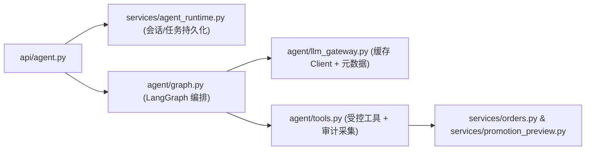

# 电商运营 Agent 架构与业务整改实施计划（P0 → P1 → P2）

## 目标与范围

针对前期业务场景与系统架构审查中识别的核心风险，在进入阶段 2（促销审批闭环）之前，按 **P0 → P1 → P2** 三个优先级完成系统性整改。所有变更严格遵循 [product-design.md](../../docs/product-design.md) 的模块化单体边界与 [DESIGN.md](../../DESIGN.md) 的桌面端视觉规范，且**不提前引入阶段 2 业务表（`promotions` / `promotion_items` / `approvals`）**。

---

## 需用户确认的变更点

> [!IMPORTANT]
> 本次整改涉及以下新增依赖与接口演进，请在确认计划时一并核准：
> 1. **后端新增开发依赖**（对齐设计文档 8.2 节）：在 [backend/pyproject.toml](../../backend/pyproject.toml) 的 `dev` 组中新增 `ruff`、`mypy`（以及必要的类型存根）。
> 2. **前端新增运行时依赖**（对齐设计文档 7.3 节）：在 [frontend/package.json](../../frontend/package.json) 中新增 `@tanstack/react-query`。
> 3. **数据库迁移**：新增两份可回滚 Alembic 迁移（`0004_agent_runtime` 与 `0005_shop_timezone_and_indexes`），覆盖 `agent_sessions`/`agent_messages`/`agent_tasks`/`agent_tool_calls` 表、`shops.timezone` 字段、订单状态检查约束与高频外键索引。
> 4. **Agent API 会话契约升级**：`POST /api/shops/{shop_id}/agent/query` 升级为以服务端 `session_id` 驱动多轮上下文（客户端不再回传未受信任的 `promotion_context`，服务端校验会话归属用户与店铺，实现真正的跨店拦截）。

---

## 阶段一：P0 核心架构与安全边界整改

### 1.1 配置管理、数据库连接池生命周期与短事务解耦
- **新增** [backend/app/core/config.py](../../backend/app/core/config.py)
  - 封装不可变 `AppSettings`（含 `database_url`、`auth`、`llm` 双渠道参数、`sandbox_business_date`、`redis_url`、`rabbitmq_url`）。
  - 启动时（`FastAPI lifespan`）一次性读取环境变量与 `.env`，避免每次请求同步读盘解析 `.env` 阻塞事件循环；同时保留测试环境下通过重新进入 `lifespan` 刷新配置的兼容性。
- **修改** [backend/app/main.py](../../backend/app/main.py) 与 [backend/app/core/db.py](../../backend/app/core/db.py)
  - 在 `lifespan` 中统一创建单例 `AsyncEngine` 与 `async_sessionmaker` 并挂载至 `app.state`，消除并发请求懒加载竞态与重复构造 `async_sessionmaker`。
- **修改** [backend/app/api/auth.py](../../backend/app/api/auth.py) 与 [backend/app/api/agent.py](../../backend/app/api/agent.py)
  - 提供 `SessionFactory` 依赖（`async_sessionmaker[AsyncSession]`）。
  - **`/api/shops/{shop_id}/agent/query` 彻底解耦 DB 事务与 LLM 调用**：鉴权时开启短 Session 完成校验并立即释放 → 无 DB 连接状态下执行外部 LLM 调用 → 工具执行与会话/任务落库各自使用独立短事务。

### 1.2 统一业务错误码与细粒度角色鉴权
- **新增** [backend/app/core/errors.py](../../backend/app/core/errors.py)
  - 定义 `AppError(status_code, code, message, detail)` 及全局异常处理器，统一输出 `{"code": "...", "message": "...", "detail": "..."}`（保留 `detail` 兼容 FastAPI 默认契约）。
- **修改** [backend/app/api/auth.py](../../backend/app/api/auth.py) 与 [backend/app/schemas/auth.py](../../backend/app/schemas/auth.py)
  - 新增 `ShopContext`（携带 `user_id`、`shop_id`、`organization_id`、`shop_name`、`timezone`、`roles`）。
  - 新增可组合依赖工厂 `require_shop_roles(*allowed_roles: Role)`，为 Agent 交互限定 `Role.OPERATOR` / `Role.ADMIN`，并为阶段 2 审批/沙箱接口预留 `Role.APPROVER` / `Role.ADMIN` 守卫。

### 1.3 Agent 单向分层重构与服务端会话持久化
目标调用链：

- **新增** [backend/app/models/agent.py](../../backend/app/models/agent.py) 与迁移 `backend/alembic/versions/0004_agent_runtime.py`
  - 落地 `agent_sessions`、`agent_messages`、`agent_tasks`、`agent_tool_calls` 四张表（关联 `users.id` 与 `shops.id`，含组合索引与可回滚 `downgrade`）。
- **重构** [backend/app/agent/llm_gateway.py](../../backend/app/agent/llm_gateway.py)
  - 按渠道配置缓存 `ChatOpenAI` 客户端复用连接池；返回包含 `llm_provider` 与 `model_name` 的结果元数据。
- **重构** [backend/app/agent/tools.py](../../backend/app/agent/tools.py) 与 [backend/app/agent/graph.py](../../backend/app/agent/graph.py)
  - 所有业务只读查询（`query_sales`、`preview_promotion`）统一经由 `agent/tools.py` 调用 `services/*`，自动记录工具名、入参摘要、响应摘要、状态与耗时，消除促销预览 `tool_calls == 0` 的盲区。
  - 将原先分散在 `services/agent.py` 中的多轮编排逻辑收归 `agent/graph.py`，移除 `services -> agent` 的倒置依赖。
- **重构** [backend/app/services/agent.py](../../backend/app/services/agent.py)
  - 负责 `agent_sessions` / `agent_messages` / `agent_tasks` / `agent_tool_calls` 的加载与持久化；当请求传入 `session_id` 时，由服务端校验归属用户与店铺——若与当前 `shop_id` 不一致，返回 `CROSS_SHOP_SESSION` 提示切回原店铺且不写入业务变更。

---

## 阶段二：P1 业务规则加固、时空抽象与数据层优化

### 2.1 统一业务时钟与店铺时区
- **新增** [backend/app/core/clock.py](../../backend/app/core/clock.py)
  - 抽象 `BusinessClock`，支持由环境变量 `SANDBOX_BUSINESS_DATE` 驱动沙箱固定业务日（默认 `2026-11-21`）或切换至真实系统时钟，彻底断开业务服务对 `seed_catalog.DEMO_DATE` 的依赖。
- **修改** [backend/app/models/org.py](../../backend/app/models/org.py)、[backend/app/services/orders.py](../../backend/app/services/orders.py)、[backend/app/services/promotion_preview.py](../../backend/app/services/promotion_preview.py)
  - `shops` 表增加 `timezone` 列（默认 `Asia/Shanghai`），`ShopAccess` 返回 `timezone`；销量窗口与促销时段均按店铺自身 `timezone` 计算。

### 2.2 升级 LLM 结构化槽位提取与破价风控
- **修改** [backend/app/schemas/agent.py](../../backend/app/schemas/agent.py) 与 [backend/app/agent/llm_gateway.py](../../backend/app/agent/llm_gateway.py)
  - 扩展 `QueryIntent` 结构化输出槽位（`kind`, `sku_code`, `discount`, `duration_days`, `start_date`, `ambiguous_terms` 等），支持通过配置选择 `function_calling` 或 `json_schema` 兼容模式。
  - 在模型抽取后保留后端确定性规则校验（如单折扣、整天数、拒绝具体时钟点与模糊区间、Decimal 价格精确复算），让“打八折 / 做三天 / 2026-11-22 开始”等自然表达均可正确解析，同时仍拦截不合法/模糊参数。
- **修改** [backend/app/services/promotion_preview.py](../../backend/app/services/promotion_preview.py)
  - 查询 `Sku.cost`，核算是否低于成本价（`promotion_price < cost`），在 `PromotionPreview` 中返回 `cost_price`、`below_cost` 与 `risk_warnings` 列表。

### 2.3 数据库索引与订单状态约束加固
- **新增迁移** `backend/alembic/versions/0005_shop_timezone_and_indexes.py`
  - 为 `shops` 添加 `timezone` 列（`String(64)`, `server_default='Asia/Shanghai'`）。
  - 为 `orders` 添加状态枚举检查约束 `ck_orders_status`（`pending / paid / partially_refunded / refunded / cancelled`），并在 `services/orders.py` 的 `sku_sales` 中显式限定曾支付成功的状态集合。
  - 补充高频外键复合索引：
    - `ix_order_items_shop_sku` (`order_items(shop_id, sku_id)`)
    - `ix_order_items_shop_order` (`order_items(shop_id, order_id)`)
    - `ix_inventory_movements_sku_created` (`inventory_movements(sku_id, created_at)`)
    - `ix_price_histories_sku_changed` (`price_histories(sku_id, changed_at)`)

---

## 阶段三：P2 前端架构治理与工程质量门禁

### 3.1 前端 API 层、TanStack Query 与 Layout Route 重构
- **新增** [frontend/src/api/client.ts](../../frontend/src/api/client.ts) 与 [frontend/src/api/queries.ts](../../frontend/src/api/queries.ts)
  - 统一封装带 Bearer 鉴权、单飞 401 Refresh 重放、业务错误码 `ApiError` 解析以及 `Idempotency-Key` 透传能力的请求客户端。
  - 引入 `@tanstack/react-query` 管理商品列表、订单列表、订单详情等服务端数据缓存与重试，消除各页面手写的 `useEffect + AbortController` 样板。
- **重构** [frontend/src/router.tsx](../../frontend/src/router.tsx) 与 [frontend/src/App.tsx](../../frontend/src/App.tsx)
  - 改为 React Router Layout Route（`<Outlet />`），维护当前活跃店铺状态 `activeShopId`（修复此前硬编码 `shops[0]` 导致的刷新判断失效问题）。
  - 顶部栏严格按 [DESIGN.md](../../DESIGN.md) 实现**多店铺切换器**（多店时展示可切换下拉，保持奶油白画布、芦荟绿高亮、细线边框与胶囊规范）。
- **更新** [frontend/src/pages/agent/index.tsx](../../frontend/src/pages/agent/index.tsx)
  - 切换为服务端 `session_id` 驱动多轮对话，展示工具调用记录数、跨店会话拦截提示及促销破价（低于成本价）风险警告。

### 3.2 真实依赖探活与静态代码质量门禁
- **修改** [backend/app/services/health.py](../../backend/app/services/health.py) 与 [backend/app/api/health.py](../../backend/app/api/health.py)
  - 保留 `/api/health` 兼容基础探活，新增 `/api/health/live` 与 `/api/health/ready`（真实检查 PostgreSQL `SELECT 1` 以及配置的 Redis / RabbitMQ TCP 连通性）。
- **修改** [backend/pyproject.toml](../../backend/pyproject.toml)
  - 引入 `ruff` 与 `mypy` 配置并修复全部类型与风格告警。

---

## 验证计划

1. **后端自动化测试与静态检查**
   - `cd backend && uv run pytest`（含 Testcontainers 真实 PostgreSQL 迁移 `upgrade/downgrade/check`、角色越权、短事务与 LLM 隔离、Agent 会话持久化与跨店拦截、破价风控、新索引与状态约束测试）。
   - `cd backend && uv run ruff check app tests scripts && uv run mypy app`。
2. **前端自动化测试与构建**
   - `cd frontend && npm test -- --run`（含多店铺切换、TanStack Query 缓存与 401 续期、Agent `session_id` 多轮对话与破价警告测试）。
   - `cd frontend && npm run build`。
3. **桌面端多视口浏览器验收**
   - 启动本地前后端后，通过浏览器子代理在 `1440x900`、`1920x1080`、`2560x1440` 三种桌面视口下验证布局完整性、多店铺切换及无意外全局滚动条。
4. **交付验证报告**
   - 完成后输出 `walkthrough.md`，汇总构建测试输出、变更明细与视口检查结果。
